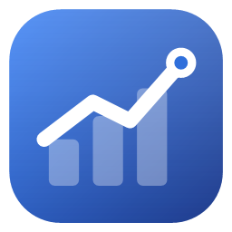
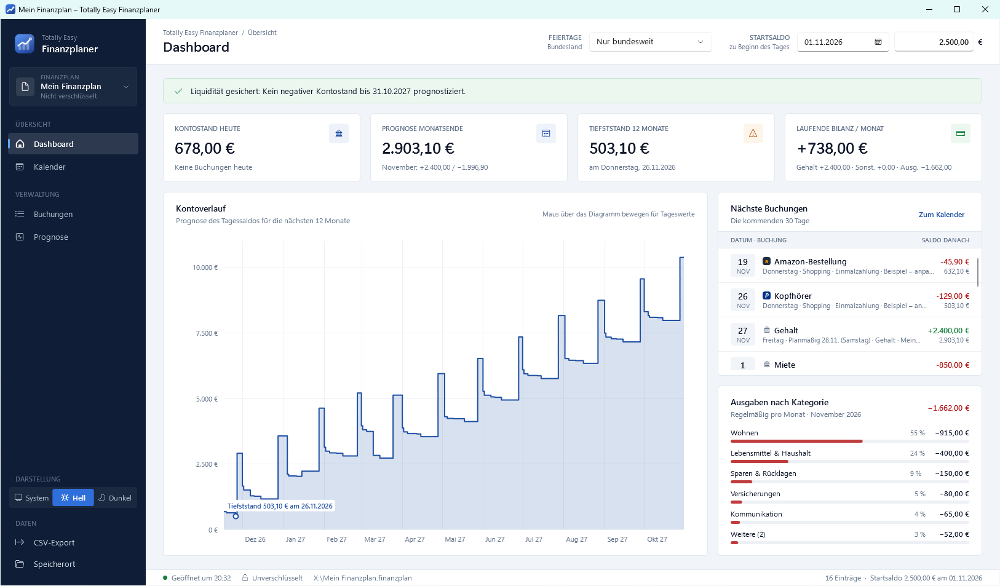
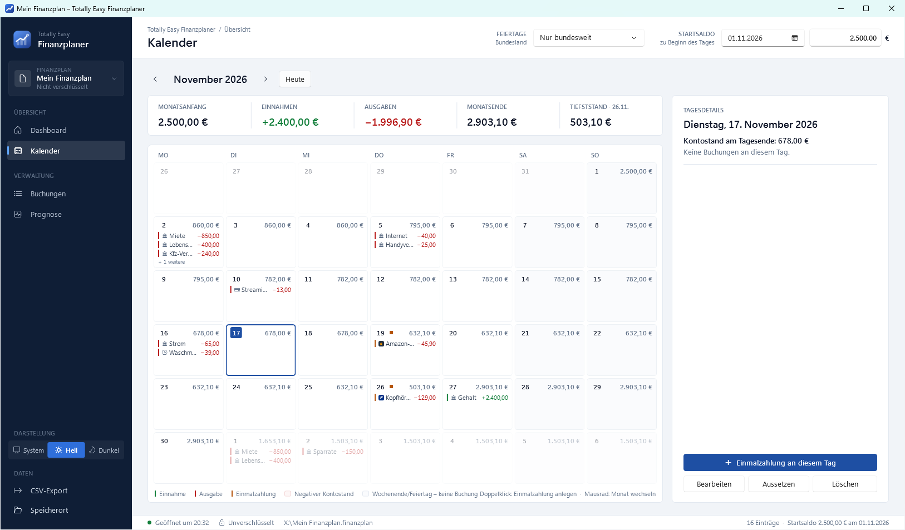
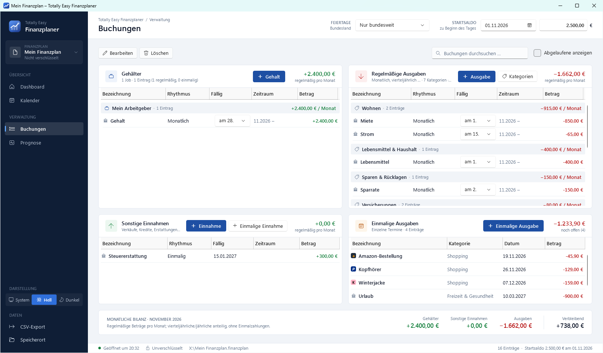
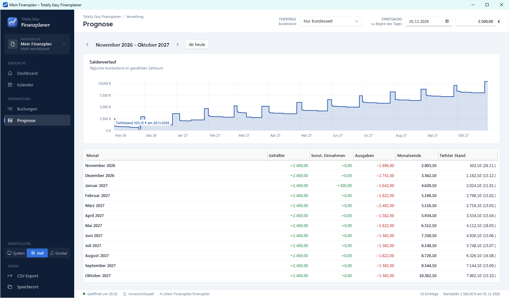
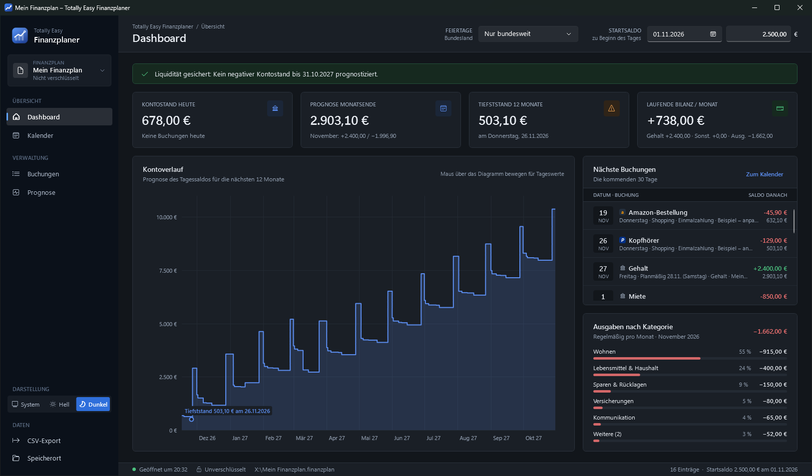
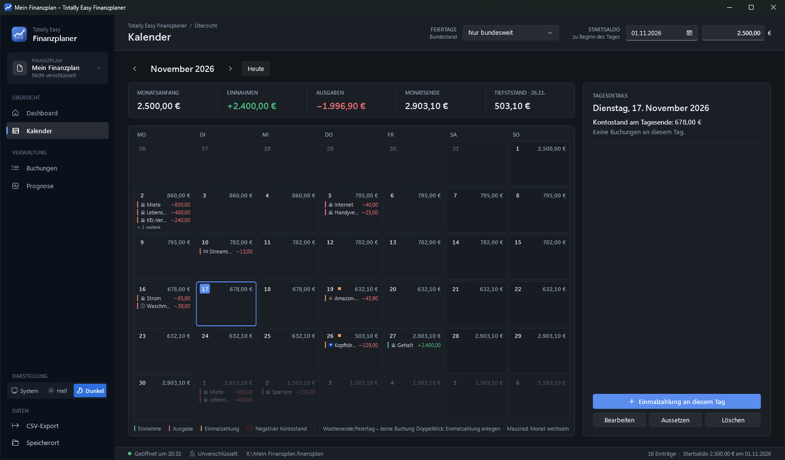
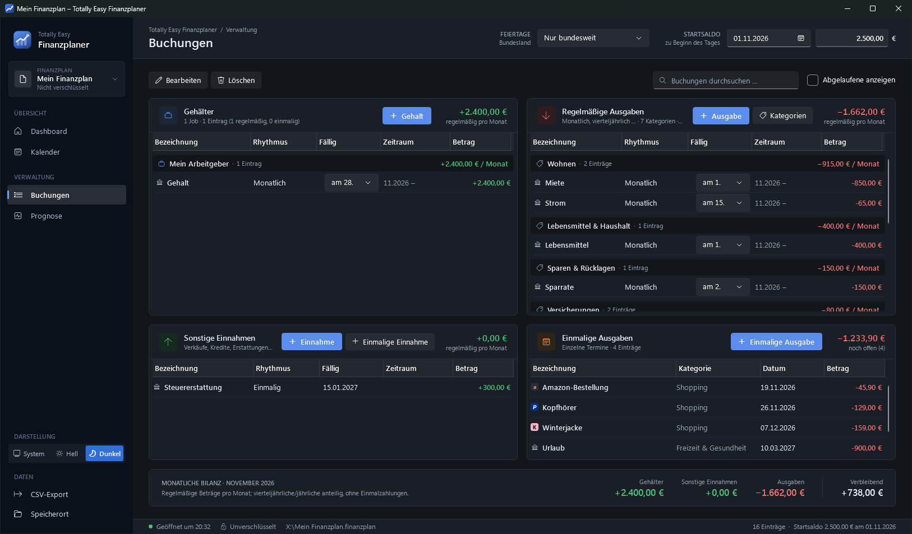
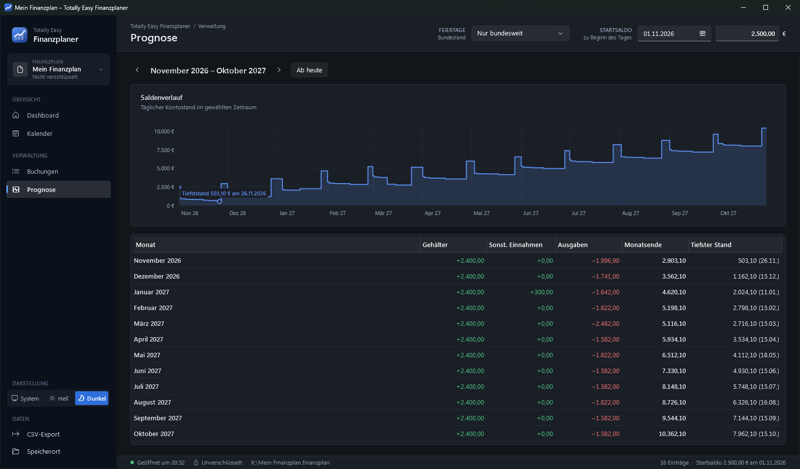

<div align="center">



# Totally Easy Finanzplaner

**Liquiditätsplanung für den Alltag: Sieh heute, wie dein Kontostand in 12 Monaten aussieht.**

[](https://dotnet.microsoft.com/)
[](https://github.com/dotnet/wpf)
[](#systemvoraussetzungen)
[](#sicherheit--verschlüsselung)
[](LICENSE)

[Funktionen](#funktionen) ·
[Screenshots](#screenshots) ·
[Installation](#installation) ·
[Bedienung](#bedienung) ·
[Datenspeicherung](#datenspeicherung) ·
[Sicherheit](#sicherheit--verschlüsselung) ·
[Lizenz](#lizenz)

<br>



</div>

---

## Überblick

Totally Easy Finanzplaner ist eine Windows-Desktop-Anwendung für die **tagesgenaue Vorschau deines
Kontostands**. Du erfasst Gehälter, sonstige Einnahmen und Ausgaben, einmalig oder wiederkehrend, und das
Programm rechnet daraus den Kontostand für jeden einzelnen Tag der nächsten 12 Monate.

So erkennst du **Engpässe, bevor sie entstehen**: Wann wird es knapp? Reicht das Geld bis zum nächsten
Gehalt? Was bleibt jeden Monat übrig?

- **Lokal:** keine Cloud, kein Konto, keine Bankanbindung, keine Telemetrie. Deine Daten bleiben auf deinem Rechner.
- **Auf Wunsch verschlüsselt:** AES-256-GCM mit Passwort.
- **Einfach:** Startsaldo eintragen, Buchungen erfassen, fertig. Gespeichert wird automatisch.

## Funktionen

### Planung
- **Drei Buchungsarten:** Gehalt (mit Arbeitgeber bzw. Job), sonstige Einnahme (Verkauf, Erstattung …) und Ausgabe (mit Kategorie)
- **Rhythmen:** einmalig, monatlich, vierteljährlich, halbjährlich, jährlich, mit „gültig ab“ und optionalem Enddatum
- **Abbuchungstag frei wählbar** (1.–30. oder „Monatsende“). Hat ein Monat weniger Tage, wird der letzte Tag genommen.
- **Abbuchungsmonate wählbar:** bei vierteljährlich, halbjährlich und jährlich (z. B. Quartal am 8. Feb · Mai · Aug · Nov)
- **Nur Werktage:** An Samstagen, Sonntagen und Feiertagen wird nicht gebucht. Der Termin wird auf den nächsten Werktag verschoben (oder auf den vorherigen vorgezogen).
- **Feiertage je Bundesland:** werden lokal berechnet (ohne Internet) und im Kalender angezeigt, samt Hinweis, wohin Buchungen verschoben werden
- **Ausgaben getrennt:** regelmäßige und einmalige Ausgaben stehen in zwei eigenen Tabellen; die Buttons in den Tabellen legen jeweils nur ihre Art an (z. B. „+ Ausgabe“ nur regelmäßige, „+ Einmalige Ausgabe“ nur einmalige Ausgaben – ebenso bei den Einnahmen)
- **Zahlungsweg mit Symbol:** Bankkonto (Standard), Kreditkarte, PayPal, Klarna, Amazon, Ratenkauf, Apple Pay oder Google Pay. Ein kleines Symbol vor jeder Buchung zeigt, worüber bezahlt wurde; abgebucht wird weiterhin vom Konto.
- **Einzelne Termine aussetzen**, ohne die ganze Serie zu löschen
- **Ausgaben-Kategorien:** 13 Standardkategorien plus eigene. Anlegen, umbenennen, zusammenführen und löschen geht in einem Dialog.

### Auswertung
- **Dashboard:** Kontostand heute, Prognose zum Monatsende, Tiefststand der nächsten 12 Monate, laufende Bilanz pro Monat
- **Liquiditätswarnung:** Hinweis, wenn der Kontostand voraussichtlich ins Minus rutscht, mit Datum und Betrag
- **Kontoverlauf als Diagramm:** tagesgenauer Saldo mit Nulllinie, markiertem Tiefststand und Werten beim Überfahren mit der Maus
- **Kalender:** Monatsansicht mit Buchungen und Tagessaldo. Tage mit negativem Kontostand sind hervorgehoben.
- **Prognose:** 12-Monats-Tabelle mit Gehältern, sonstigen Einnahmen, Ausgaben, Monatsende und tiefstem Stand
- **Ausgaben nach Kategorie:** regelmäßige Kosten pro Monat, anteilig umgerechnet (z. B. vierteljährlich ÷ 3)

### Komfort
- **Mehrere Finanzpläne** (z. B. privat und gemeinsam). Zuletzt geöffnete Pläne stehen im Menü, Dateien lassen sich per Drag & Drop öffnen.
- **Automatisches Speichern** nach jeder Änderung. Gespeichert wird atomar, ein Abbruch kann die Datei also nicht beschädigen.
- **CSV-Export** für Excel (UTF-8 mit BOM, Semikolon-getrennt, geschützt gegen Formel-Injection)
- **Helles und dunkles Design**, wahlweise automatisch passend zu Windows
- **Portabler Betrieb** vom USB-Stick möglich ([Details](#portabler-modus))

## Screenshots

<table>
  <tr>
    <td width="50%"></td>
    <td width="50%"></td>
  </tr>
  <tr>
    <td align="center"><b>Dashboard</b>: Kennzahlen, Kontoverlauf, nächste Buchungen</td>
    <td align="center"><b>Kalender</b>: Buchungen und Tagessaldo im Monatsüberblick</td>
  </tr>
  <tr>
    <td width="50%"></td>
    <td width="50%"></td>
  </tr>
  <tr>
    <td align="center"><b>Buchungen</b>: nach Job und Kategorie gruppiert</td>
    <td align="center"><b>Prognose</b>: 12 Monate im Überblick</td>
  </tr>
</table>

<details>
<summary><b>Dunkles Design ansehen</b></summary>
<br>

<table>
  <tr>
    <td width="50%"></td>
    <td width="50%"></td>
  </tr>
  <tr>
    <td width="50%"></td>
    <td width="50%"></td>
  </tr>
</table>

</details>

> Die Screenshots zeigen die mitgelieferten Beispieldaten.

## Systemvoraussetzungen

| | |
|---|---|
| **Betriebssystem** | Windows 10 (ab 20H1) oder Windows 11, x64 |
| **Laufzeit** | [.NET 10 Desktop Runtime](https://dotnet.microsoft.com/download/dotnet/10.0). Bei einer *self-contained*-Version ist keine Installation nötig. |
| **Zum Bauen** | [.NET 10 SDK](https://dotnet.microsoft.com/download/dotnet/10.0), optional Visual Studio 2026 oder JetBrains Rider |

## Installation

### Download (empfohlen)

Die fertige Version gibt es unter **[Releases](../../releases/latest)**:

| Datei | Beschreibung |
|---|---|
| `TotallyEasyFinanzplaner-<Version>-win-x64.exe` | Läuft sofort ohne Installation. Einfach herunterladen und starten. |
| `TotallyEasyFinanzplaner-<Version>-win-x64-framework-dependent.zip` | Kleine Variante, benötigt die [.NET 10 Desktop Runtime](https://dotnet.microsoft.com/download/dotnet/10.0). |

> [!NOTE]
> Die `.exe` ist nicht digital signiert. Windows SmartScreen kann deshalb beim ersten Start warnen.
> Über **Weitere Informationen → Trotzdem ausführen** lässt sich das Programm starten. Die Prüfsummen in
> `SHA256SUMS.txt` bestätigen, dass der Download unverändert ist.

### Aus dem Quellcode starten

```powershell
git clone <repository-url>
cd TotallyEasyFinanzplaner
dotnet run --project TotallyEasyFinanzplaner
```

### Eigenständige `.exe` erstellen

Eine einzelne, eigenständige Datei, die ohne installiertes .NET läuft:

```powershell
dotnet publish TotallyEasyFinanzplaner/TotallyEasyFinanzplaner.csproj `
  -c Release -r win-x64 --self-contained true `
  -p:PublishSingleFile=true -p:IncludeNativeLibrariesForSelfExtract=true `
  -o publish
```

Ergebnis: `publish/TotallyEasyFinanzplaner.exe` (ca. 130 MB, enthält die .NET-Laufzeit).
Mit installierter .NET 10 Desktop Runtime geht es deutlich kleiner: `--self-contained false`.

## Bedienung

### Erste Schritte

1. **Programm starten.** Beim ersten Start wird ein Standardplan mit Beispieldaten angelegt.
2. **Stichtag und Startsaldo** oben rechts eintragen: Kontostand zu Beginn dieses Tages.
3. Unter **Buchungen** die Beispiele anpassen oder löschen und eigene Gehälter, Einnahmen und Ausgaben erfassen.
4. Im **Dashboard** und in der **Prognose** sofort sehen, wie sich der Kontostand entwickelt.

Ein Doppelklick auf einen Kalendertag legt dort direkt eine Einmalzahlung an. Über **Aussetzen** in den
Tagesdetails lässt du einen einzelnen Termin einer Serie entfallen, etwa eine Rate, die einmal nicht abgebucht wird.

### Tastenkürzel

| Kürzel | Aktion |
|---|---|
| <kbd>Strg</kbd> + <kbd>N</kbd> | Neuer Finanzplan |
| <kbd>Strg</kbd> + <kbd>O</kbd> | Finanzplan öffnen |
| <kbd>Strg</kbd> + <kbd>S</kbd> | Speichern |
| <kbd>Strg</kbd> + <kbd>Umschalt</kbd> + <kbd>S</kbd> | Speichern unter … |
| <kbd>Strg</kbd> + <kbd>1</kbd> … <kbd>4</kbd> | Dashboard · Kalender · Buchungen · Prognose |
| <kbd>Strg</kbd> + <kbd>F</kbd> | Buchungen durchsuchen |
| <kbd>Strg</kbd> + <kbd>Umschalt</kbd> + <kbd>D</kbd> | Hell/Dunkel umschalten |
| <kbd>Bild ↑</kbd> / <kbd>Bild ↓</kbd> · Mausrad im Kalender | Vorheriger / nächster Monat |
| Doppelklick auf einen Kalendertag | Einmalzahlung an diesem Tag anlegen |
| Doppelklick auf einen Monat in der Prognose | Monat im Kalender öffnen |

## Datenspeicherung

| Datei | Ort | Inhalt |
|---|---|---|
| `daten.json` | `%APPDATA%\TotallyEasyFinanzplaner\` | Standardplan |
| `einstellungen.json` | `%APPDATA%\TotallyEasyFinanzplaner\` | Design, zuletzt geöffnete Pläne |
| `*.finanzplan` | frei wählbar (Vorschlag: `Dokumente\Finanzpläne`) | weitere Finanzpläne |

- **Format:** lesbares JSON (UTF-8). Verschlüsselte Pläne sind Binärdateien (siehe unten).
- **Sicherungen:** Vor einer automatischen Formatumstellung wird die alte Datei gesichert
  (`<Name>.vor-v3-<Datum>.<Endung>`). Ist der Standardplan unlesbar, wird er als
  `<Name>.defekt-<Datum>.json` gesichert, bevor das Programm mit leeren Daten startet. Andere Pläne werden in
  diesem Fall gar nicht erst geöffnet.
- **CSV-Export:** über **Daten → CSV-Export** in der Seitenleiste. Exportiert alle Buchungen für Excel.

### Portabler Modus

Liegt eine `daten.json` **im selben Ordner wie die `.exe`**, nutzt das Programm diesen Ordner für Plan und
Einstellungen statt `%APPDATA%`. Ideal für einen USB-Stick: Ordner mit `.exe` und `daten.json` kopieren, fertig.

## Sicherheit & Verschlüsselung

Jeder Finanzplan lässt sich optional mit einem Passwort schützen, beim Anlegen oder später über das Planmenü.

| | |
|---|---|
| **Verfahren** | AES-256-GCM (authentifizierte Verschlüsselung: falsche Passwörter und manipulierte Dateien werden erkannt) |
| **Schlüsselableitung** | PBKDF2-HMAC-SHA256 mit 600.000 Iterationen (OWASP-Empfehlung) und zufälligem 128-Bit-Salt |
| **Nonce** | bei jedem Speichern neu, zufällig (96 Bit) |
| **Passwort** | mindestens 8 Zeichen. Es wird **nie gespeichert**, nur der abgeleitete Schlüssel liegt während der Sitzung im Arbeitsspeicher. |
| **Dateikopf** | `FPLANENC` · Version · Iterationen · Salt · Nonce · Tag · Geheimtext. Der Kopf ist mit authentifiziert. |

> [!WARNING]
> **Es gibt keine Passwort-Wiederherstellung.** Ohne das Passwort lässt sich ein verschlüsselter Plan nicht
> mehr öffnen. Bewahre es sicher auf, zum Beispiel in einem Passwort-Manager.

Beim Verschlüsseln bietet das Programm an, ältere unverschlüsselte Sicherungskopien desselben Plans zu löschen.

## Projektstruktur

```
TotallyEasyFinanzplaner/
├── App.xaml(.cs)            Programmstart, Kultur de-DE, globale Fehlerbehandlung
├── Models/                  Datenmodell: Entry (Buchung + Terminberechnung), FinanceData, Texte & Beträge
├── Services/
│   ├── DataStore.cs         Laden/Speichern, Formatumstellung, Sicherungen
│   ├── PlanCrypto.cs        AES-256-GCM + PBKDF2
│   ├── Forecast.cs          Tagesgenaue Saldenberechnung, Monatsstatistik
│   ├── AppSettings.cs       Einstellungen, zuletzt geöffnete Pläne
│   ├── ThemeManager.cs      Hell/Dunkel, Titelleiste
│   └── SeedData.cs          Beispieldaten für den ersten Start
├── Views/
│   ├── MainWindow.*         Hauptfenster (Dashboard, Kalender, Buchungen, Prognose, Planverwaltung)
│   ├── Dialogs/             Buchung, Kategorien, Passwort, Neuer Plan, Meldungen
│   ├── Controls/            Saldendiagramm, Passwortfelder mit Stärkeanzeige
│   └── Support/             Anzeige-Modelle und Converter
├── Resources/               Farbpaletten (hell/dunkel) und Styles
└── Assets/                  Programmsymbol (erzeugt von make_icon.ps1)
```

## Haftungsausschluss

Totally Easy Finanzplaner ist ein Planungswerkzeug. Die Prognose beruht ausschließlich auf den von dir
eingegebenen Daten und ersetzt **keine Finanz-, Steuer- oder Anlageberatung**. Es erfolgt kein Abgleich mit
deinem tatsächlichen Konto.

## Lizenz

Veröffentlicht unter der **[MIT-Lizenz](LICENSE)**. © 2026 sempt3x

Verwendete Komponenten (.NET, WPF) und deren Lizenzen stehen in
**[THIRD-PARTY-NOTICES.md](THIRD-PARTY-NOTICES.md)**.

<div align="center">
<br>
<sub>Entwickelt mit .NET 10 und WPF.</sub>
</div>
